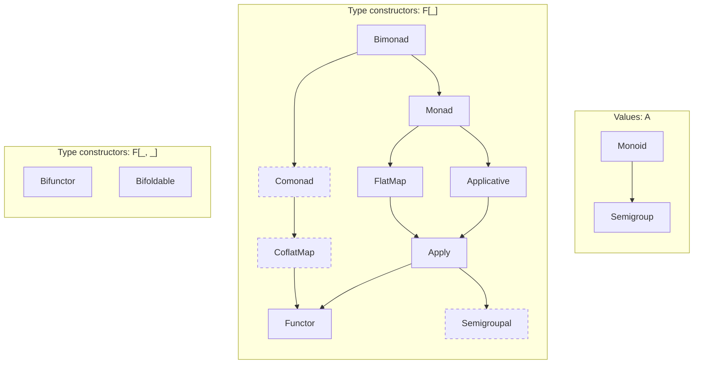

Arrows point from a [[TypeClass]] to the one it extends, following the [Cats](https://typelevel.org/cats/typeclasses.html) hierarchy. Groups are the [[Kinds|Kind]] of type each one abstracts over. Click a box to open its note, dashed boxes don't have a note yet. [[Free Monad]] isn't on here because it's a data type, not a TypeClass, it gives any `F[_]` a [[Monad]].
